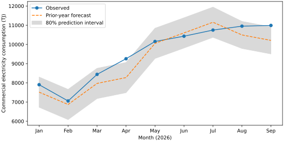
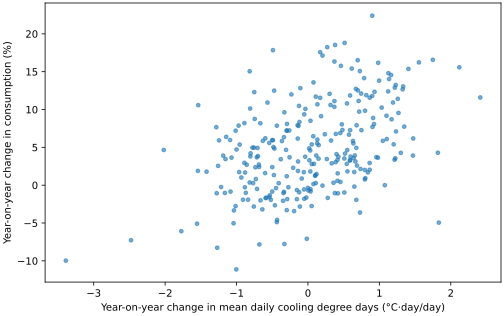

# Hong Kong Commercial Electricity Demand and Heat Risk

[中文](README.md) · **English**

This project forecasts next month's commercial electricity consumption in Hong Kong, measured in terajoules (TJ), and estimates demand under warmer weather scenarios.

## Project results

| Stage | Completed work | Evidence |
|---|---|---|
| Source verification | Reconciled 2025 commercial electricity use against two editions of the Monthly Digest and checked 365 daily temperature records. | [Sample audit (Chinese)](docs/第一阶段数据可行性核验报告.md) |
| Historical coverage | Extended the initial 132-month panel to 573 monthly observations beginning in January 1979 and assembled 17,471 days of headquarters weather records. | [Initial panel audit (Chinese)](docs/第二阶段完整历史核验报告.md) · [Weather audit (Chinese)](docs/weather-history.md) |
| Model evaluation | Compared a prior-year benchmark with exponential smoothing, temperature regression and heat ridge regression using rolling forecast errors and interval coverage. | [Evaluation protocol (Chinese)](docs/model-protocol.md) |
| Heat exposure | Compared 276 warm-season months with the corresponding months a year earlier to study changes in cooling degree days and electricity use. | [Analysis script](scripts/explore-weather-history.mjs) |
| Monthly forecasts | Preserved dated forecasts, 80% intervals and warm-weather scenarios for subsequent verification against published observations. | [Forecast and verification archive](docs/forecast-archive.md) |

## Forecast errors and interval coverage of the prior-year benchmark

Commercial demand varies with the season. Using the same month a year earlier gives a benchmark that anyone can reconstruct. For January–September 2026, we carried forward each corresponding 2025 observation and compared it with the published monthly total in C&SD Table 915-91201. At each forecast origin, the grey band uses the 49th smallest of the latest 60 available absolute forecast errors as its half-width. The backtest assumes a three-month data lag and uses the current release of the historical series.

  

The forecast tracked much of the spring-to-summer rise. In April, observed demand reached **9,256 TJ**, exceeding the point forecast by **981 TJ** and the upper bound by **194 TJ**. In September, demand reached **10,990 TJ**, exceeding the forecast by **779 TJ** and the upper bound by **74 TJ**. Only April was warmer than its historical same-month 80th percentile. The two misses warrant examining drivers beyond temperature.

| Model and history start | WAPE ↓ | Months inside 80% interval | Mean interval width (TJ) |
|---|---:|---:|---:|
| Seasonal naive (prior-year month) | 4.58% | 7/9 | 1,538 |
| Seasonal exponential smoothing (1979) | 5.49% | 6/9 | 1,025 |
| Heat ridge regression (2015) | 5.54% | 6/9 | 1,001 |
| Linear temperature regression (2015) | 5.59% | 5/9 | 1,020 |

All rows cover January–September 2026. WAPE divides the sum of absolute forecast errors by total observed demand. The prior-year forecast had the lowest error and the widest intervals among these four. Its selection as the December alternative used these nine outcomes; future months will provide an independent check.

The expanded comparison used 2020–October 2022 for model selection and 2023–2025 for diagnostics. Each rolling forecast uses data through three months before the target month. Historical values come from the current statistical release; historical first-release values may differ. The heat model uses cooling degree days above 24°C, the share of days reaching 33°C, and the share of nights with a daily minimum of at least 28°C. [Model protocol (Chinese)](docs/model-protocol.md)

## Warm-season changes in cooling degree days and electricity consumption

To reduce the effect of recurring seasonality, we paired each May–October observation with the same calendar month one year earlier. For each day at Hong Kong Observatory Headquarters, we took the positive part of mean temperature minus 24°C, then averaged over the month. The horizontal axis measures the year-on-year difference in that cooling indicator. The vertical axis measures the percentage change in commercial electricity consumption. Each dot represents one month: six per year from 1980 through 2025, giving 276 pairs. The 1979 observations supply the first reference year.

  

The upward slope of the point cloud indicates a positive association (Pearson **r = 0.448**). Demand tended to rise when the cooling indicator increased, though consumption also moved substantially in months with little change in cooling exposure. Same-month comparisons account for recurring seasonality, while economic activity, working-day patterns and long-term changes can still affect demand. This relationship uses observed weather. A month-ahead forecast must also contend with uncertainty about that weather, so its predictive value is assessed in the rolling backtest.

## Data and reproduction

Hong Kong Census and Statistics Department table 915-91201 provides 573 monthly commercial observations (January 1979–September 2026). The Hong Kong Observatory headquarters series contributes 17,471 days of mean, maximum and minimum temperature and relative humidity (January 1979–October 2026). Daily weather is aggregated to match the monthly demand target. [Electricity source](https://www.censtatd.gov.hk/en/web_table.html?id=915-91201) · [Weather sources and checks (Chinese)](docs/weather-history.md)

From the repository root on Windows, use PowerShell 7, curl and Node.js (tested with Node 24). The first two commands download official data.

~~~powershell
pwsh -File scripts/fetch-energy-next.ps1
node scripts/fetch-weather-next.mjs
node scripts/heat-backtest.mjs
node scripts/alternative-forecast.mjs
python -m pip install numpy matplotlib
python scripts/research_figures.py
~~~

Research figures are exported directly from project data with Python 3, NumPy and Matplotlib. Axes, units and legends appear in the figures; methods and interpretation accompany them in the text.

The rolling forecasts are in `data/next/predictions.csv`, scores in `scores.json`, weather scenarios in `future.json` and the December alternative in `alternative.json`, all under the same directory. Raw downloads and local result files are Git-ignored. Official sources may revise their historical values.
