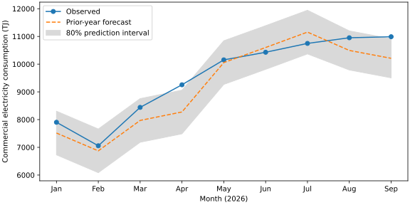
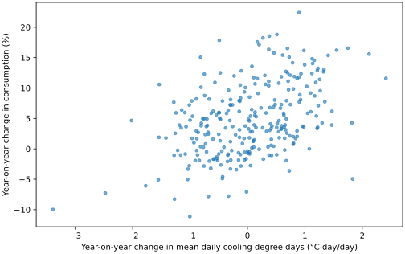

# 香港商业用电预测与高温风险分析

**中文** · [English](README.en.md)

预测香港商业用户下一完整自然月的本地用电量，并估计偏暖天气下的需求变化。

## 最新研究预测 · 2026 年 12 月

2026 年 11 月 28 日出具，用电数据截至 9 月。上年同月模型给出的点预测为 **7,772 TJ**，名义 80% 预测区间为 **7,071–8,473 TJ**。

2026 年 1–9 月，上年同月模型的 WAPE 为 4.58%，预测区间覆盖 7/9 个月。选用该模型时已参考这九个月的结果，后续月份将用于检验其表现。独立气温模型估计，12 月由历史同月中位温度升至第 80 百分位时，需求增加约 74 TJ。[月度报告](docs/2026-12-forecast.md) · [模型与验证规则](docs/model-protocol.md) · [天气数据来源](docs/weather-history.md)

## 图 1　上年同月能否预测今年的用电量？

商业用电有明显的季节变化。一个直接的检验是：只知道去年同月用了多少电，今年能预测到什么程度？我们用2025年各月的商业用电量逐月预测2026年1–9月，再与统计处表915-91201中的实测值对照。灰带宽度随月更新：在假设的数据截止日（目标月前三个月），取最近60个可见的历史绝对误差，以其第49小值作为区间半宽。历史回测使用当前发布的统计版本。

上年同月预测跟随了春夏用电量上升的大方向，但有两次低估超出了灰带。4月实际用电 **9,256 TJ**，比点预测高 **981 TJ**，比区间上界高 **194 TJ**；9月实际用电 **10,990 TJ**，比点预测高 **779 TJ**，比上界高 **74 TJ**。两个月中只有4月的实测均温超过历史同月第80百分位。偏暖值得研究，单凭气温还解释不了这两次偏差。

|模型（历史起点）|WAPE，越低越好|80%区间命中|平均区间宽度（TJ）|
|---|---:|---:|---:|
|上年同月|4.58%|7/9|1,538|
|季节指数平滑（1979）|5.49%|6/9|1,025|
|高温岭回归（2015）|5.54%|6/9|1,001|
|气温线性回归（2015）|5.59%|5/9|1,020|

统一比较2026年1–9月。WAPE为各月绝对误差之和除以同期实测总量。上年同月模型在这四个模型中误差最低，区间也最宽。

## 图 2　同一个月份比去年热，用电量是否也会上升？

直接比较冬夏会混入固定的季节差异。因此我们只取5–10月，用每个月与上一年同月配对。先用天文台总部站日均温计算每日超过24°C的部分（低于阈值记零），再取全月平均，作为制冷需求的气象指标。横轴是该指标与上年同月的差，纵轴是商业用电量同比变化百分比。每个点代表一个月；1980–2025年共46年、每年6个月，得到276对观测。1979年提供首组同比基数。

点云整体向右上方倾斜，皮尔逊相关系数为 **0.448**。与去年同月相比，制冷度日增加时，用电量也倾向于增长。但在横轴接近零的位置，用电量仍有明显的上升和下降。同比配对减少了固定季节性的影响，经济活动、工作日安排和长期变化仍会影响结果。这项关联来自实测天气；提前预测时还需要估计目标月的天气，这也是图1要单独检验预测误差的原因。

## 复现最新结果

在仓库根目录使用 PowerShell 7、curl 和 Node.js 运行以下命令。上年同月预测保存在 data/next/alternative.json，其他候选模型的比较结果保存在 data/next/scores.json。

~~~powershell
pwsh -File scripts/fetch-energy-next.ps1
node scripts/fetch-weather-next.mjs
node scripts/heat-backtest.mjs
node scripts/alternative-forecast.mjs
python -m pip install numpy matplotlib
python scripts/research_figures.py
~~~

正文研究图由 Python 和 Matplotlib 读取逐月回测、逐日气温与用电数据直接导出。图内保留坐标轴、单位及必要图例，研究方法与解读置于正文。

## 首轮实验复现

使用 PowerShell 7、curl 和 Node.js（本次为24.22）。在仓库根目录运行：

~~~powershell
pwsh -File scripts/prepare.ps1
node scripts/backtest.mjs
node scripts/explore-heat.mjs
~~~

数据来自香港政府统计处和香港天文台，来源、署名与使用条件见 docs/ 中两份中文核验报告。原始数据和逐月输出仅在本地生成。官方接口可能修订历史值。

## 首轮实验结果（2015–2025 年样本）

目标为月用电量除以月日数的日均需求。对历史日均需求与月均温分别减去各自同一历月的历史均值，用最小二乘估计一条跨月共用的气温斜率 β。预测某月时，把历年同月日均需求调整到同一参考温度 T：调整值 = 日均需求 + β × (T − 当年月均温)。对调整值按年做指数平滑，新值权重 α，最后乘目标月日数。初值为最早同月的调整值。常年和偏热 T 分别使用当时可见同月均温的均值和经验第80百分位。

2015–2019年提供初始历史，2020–2022年按月向前验证，在四个平滑系数和有无气温项的八个组合中按 MAE 选择，选中 α=0.25、有气温项。保留2023–2025年36个月测试；预测目标月 t 时假设最新可见月为 t−3。区间半宽取已可见滚动绝对误差的经验次序统计量，目标覆盖80%，实测33/36。回测采用当前修订版，逐月首发日未知。

|测试月分组|月数|含气温平滑 WAPE|同系数无气温平滑|上年同月|
|---|---:|---:|---:|---:|
|全部|36|3.704%|3.528%|3.882%|
|相对偏热|7|5.485%|5.366%|2.893%|
|其余|29|3.232%|3.042%|4.144%|

相对偏热定义为目标月实测均温严格高于当时历史同月的经验第80百分位，分组仅供事后诊断。每历月总共11个观测，偏热阈值容易受个别年份影响。4018个气温日只能配对132个月度需求标签。

探索中先剔除历月平均季节性，日均用电与月均温的相关系数为0.518，与日均冷却度日指标为0.563。后者逐日计算 max(日均温−24°C,0) 后按月平均；24°C 为探索参数。以上为全期描述性相关，未控制趋势、节假日和经济活动。首轮结果尚未证实气温项改善预测。应核查更长同口径历史、日最高及最低温、湿度、多站点和逐期可得天气输入，检验非线性制冷负荷及连续热日，再用新留出期评估。
