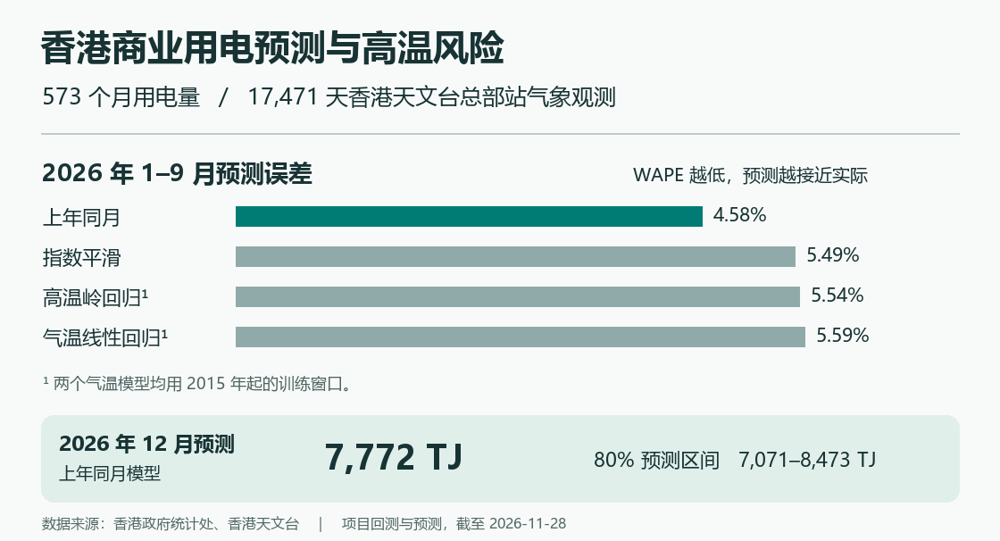

# 月度预测档案 · Monthly forecast archive

[项目首页](../README.md) · [Project overview](../README.en.md)

每期报告按目标月份独立保存。新预测在表首追加一行。统计处发布实测后，补录实测值、点预测误差（实测减预测）、区间命中情况和核验日期。原始预测保留发布时版本。

Each row links to the forecast as issued. When C&SD publishes the observation, the verification entry records the observed value, signed error (actual minus forecast), interval coverage and verification date. All quantities are in TJ.

| 目标月 / Target | 出具日 / Issued | 点预测 / Forecast | 80% interval | 核验 / Verification | 发布记录 / Record |
|---|---|---:|---:|---|---|
| 2026-12 | 2026-11-28 | 7,772 | 7,071–8,473 | 待实测 / Pending | [原始报告 / As issued](https://github.com/atabey404/hong-kong-electricity-heat-risk/blob/68428a92c58db0c884e5c9370754e7fdb76dabc3/docs/2026-12-forecast.md) |

### 2026-12 · 天气情景 / Weather scenarios

同一期独立温度回归给出的需求为7,686 TJ（18.88°C，中位情景）和7,760 TJ（19.22°C，偏暖情景），情景间相差74 TJ。

The temperature regression estimates 7,686 TJ at 18.88°C and 7,760 TJ at 19.22°C, a 74 TJ difference between the historical median and warmer December scenarios.

  

